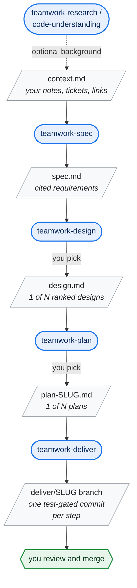
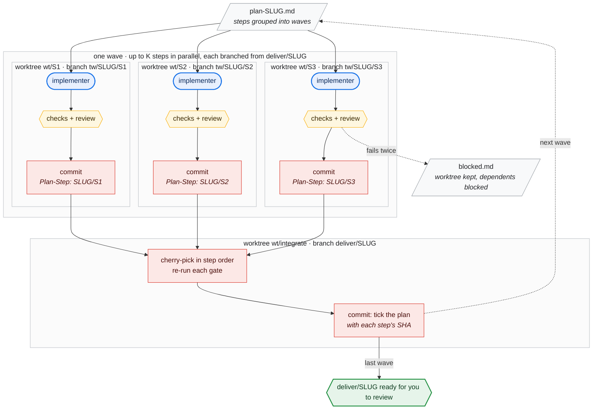

# teamwork

Skills for [skills.sh](https://skills.sh) that run a team of subagents against an objective: scouts explore, you pick focus areas and experts from a UI prompt, cited SMEs plus an adversarial and a contrarian member do the work, adversaries cross-examine the SMEs' claims, verifiers re-check every citation, a judge rules (one right of reply per questionable statement), a synthesiser writes the output from the included claims only (trace-checked back to the rulings), and an editor de-slops document outputs.

## Install

```
npx skills add g15ecb/teamwork
```

Installs all seven skills.

**You must always install `teamwork-core`.** `teamwork-research`, `teamwork-spec`, `teamwork-design`, `teamwork-plan` and `teamwork-code-understanding` are thin wrappers that call it and do nothing without it; `teamwork-deliver` reads its rules. If you install skills selectively, include it:

```
npx skills add g15ecb/teamwork --skill teamwork-core --skill teamwork-research
```

`teamwork-plan` and `teamwork-deliver` need `python3` 3.9 or later on the PATH (standard library only, no packages): the graph check uses `graphlib`.

## Workflow

Each skill's output is the next one's input. Commit each document as you go: `teamwork-deliver` records progress in git.



### How `teamwork-deliver` uses worktrees

Each step gets its own implementer in its own worktree, branched from `deliver/SLUG`. Passing steps are cherry-picked into an integration worktree on `deliver/SLUG`, and the next wave branches from the result. Your checkout is never touched.



## Skills

| Skill | Invoke | Takes → writes | What it does |
|---|---|---|---|
| `teamwork-research` | `teamwork-research: <topic>` | topic → `SLUG.md` | Cited research report. You confirm sources (web, this repo, repo + web, given files) and shape (how it works, background, compare, reference, fit); can read upstream source code |
| `teamwork-code-understanding` | `teamwork-code-understanding: <topic>` | topic → `understanding-SLUG.md` | `teamwork-research` preset to repo + web sources and the fit shape; needs `teamwork-research` |
| `teamwork-spec` | `/teamwork-spec path/to/context.md [format]` | context → spec | Every requirement step cited to the context. Your format, the project's, else Gherkin |
| `teamwork-design` | `/teamwork-design path/to/spec.md [format]` | spec → design doc | Architects with different stances propose designs, an adversary pre-mortems them, and each is scored 0-5 on eight metrics (spec coverage, simplicity, idiomatic fit, maintainability, safety, future-proofing, operability, testability). You pick from the ranked table. Each spec component is traced to the code it changes |
| `teamwork-plan` | `/teamwork-plan path/to/design.md [format]` | design → TODO plan | Breaks the design into steps, one test-gated commit each, scheduled in parallel waves. Planners (parallel-first, safe increments, vertical slices) are audited for missing and needless dependencies; you pick the plan. A bundled script checks the graph and computes the recommended subagent count |
| `teamwork-deliver` | `/teamwork-deliver path/to/plan.md` | plan → `deliver/SLUG` branch | One implementer per step in its own worktree, wave by wave. Checks each step mechanically (touches only its files, gate passes, new tests fail without the change), optionally reviews it, and lands it as one commit with a `Plan-Step` trailer. Ticks the plan once per wave; re-runs resume. A step that fails twice blocks its dependents. You approve every command; never touches your checkout or pushes. Needs `teamwork-plan` for its graph script |
| `teamwork-core` | (not invoked directly) | — | Private engine. The wrappers call it with a parameter block; `teamwork-deliver` reuses its orchestration rules and models |

Scratch ledgers and rulings live in `.teamwork/<slug>/`.

## Models

Each subagent is spawned on a fixed model, whatever model your session uses. The orchestrator (your session) should be Opus: it merges the scout reports, picks the team and writes every agent prompt. On hosts with no per-agent model setting, every agent runs on the session model.

| Role | Model | Why |
|---|---|---|
| Orchestrator (your session) | Opus (recommended) | Merges scouts, picks the team, writes standalone prompts, routes right of reply |
| Scouts | Sonnet | Shallow sketches, 400 words or fewer |
| SMEs, adversarial, contrarian, architects, planners, tester, implementers, reviewers | Opus | Expert depth and counter-example hunting decide output quality; implementing a step and reviewing its diff are judgment work |
| Web researchers | Sonnet | Fetch and cite non-code context |
| Verifiers | Sonnet | Narrow check: quote present, statement entailed. Highest call count |
| Judge | Opus | Weighting, contradictions and fidelity; everything downstream depends on it |
| Synthesiser | Opus | Frames the explanation without adding facts |
| Editor, format verifier | Sonnet | Mechanical, and checked by shell diffs |
